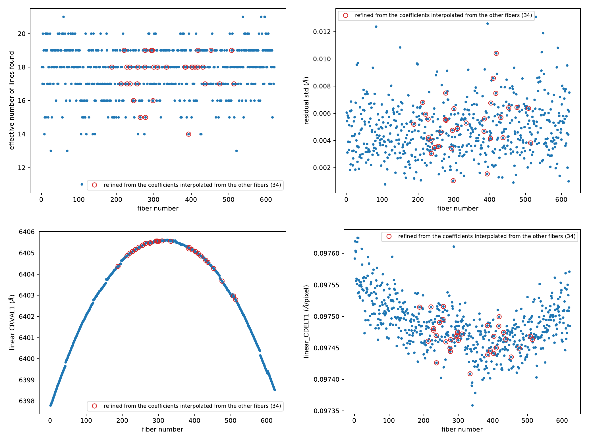
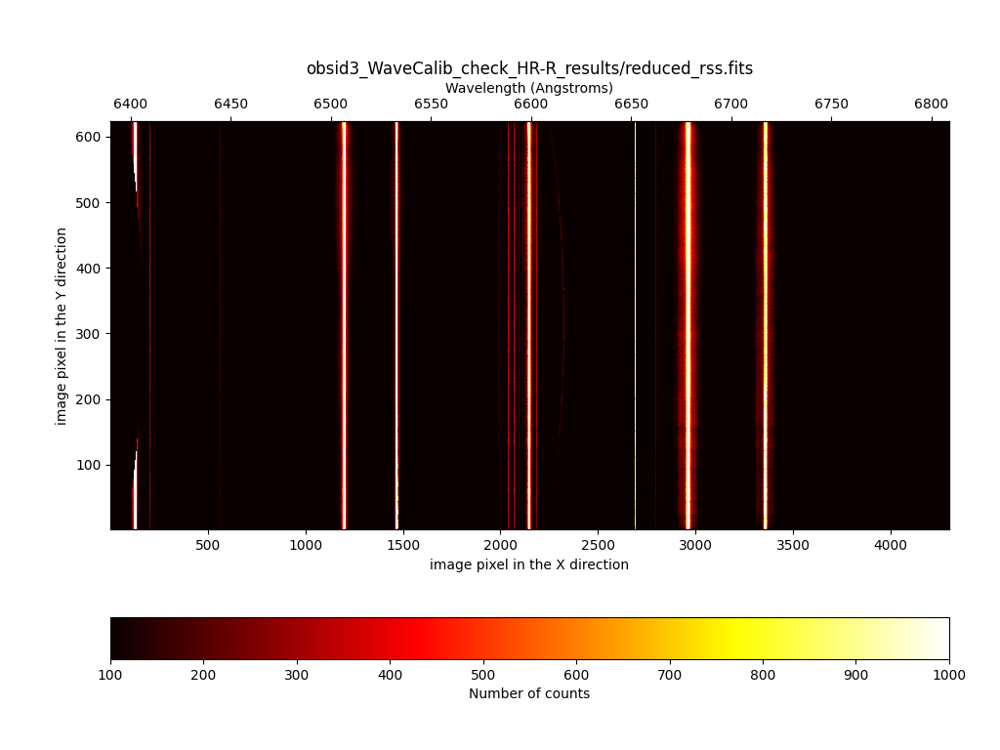
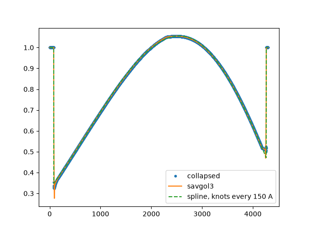
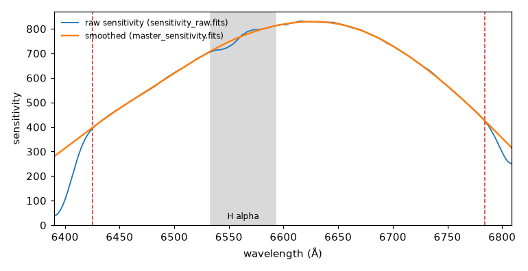
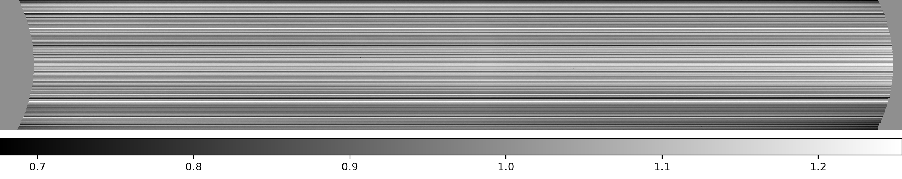
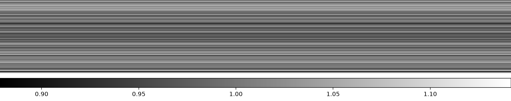

**************
Data reduction
**************

.. warning::

   Since February 2026, a new, more simplified data reduction procedure has
   been implemented. These changes were introduced in **megaradrp
   version 0.20.0**.

   In particular:

   - the auxiliary file ``control.yaml`` is no longer necessary
   - the calibration tree is automatically built using ``megaradrp-inittree``,
     as explained below
   - the auxiliary calibration file ``extinction_LP`` is now part of the
     calibration tree and no longer needs to be stored in the ``data``
     subdirectory; the requirement ``reference_extinction: extinction_LP.txt``
     should no longer appear in the observation result file (unless the user
     needs to use a different extinction table, in which case the requirement
     can be set and the corresponding file should be placed in the ``data``
     subdirectory)

   Concerning the label used to identify the calibration path, for observations
   carried out before February 2026 this label is the original
   ``ca3558e3-e50d-4bbc-86bd-da50a0998a48`` sequence, whereas for images
   obtained after February 2026 the label to store the calibrations is
   ``9f3fecbf-376c-47ae-a188-313b7d829104``.

Getting Started
===============

The first step to start the data reduction is to activate your
environment (see details in section :ref:`DRP_installation`).

The next step is to download the data employed in this cookbook:
`megara-cookbook-v5.tar.gz
<https://guaix.fis.ucm.es/data/megaradrp/megara-cookbook-v5.tar.gz>`_

.. note::

   The only difference with the previous version, ``megara-cookbook-v4.tar.gz``,
   is the ``extraction_offset`` of the standard star in
   ``6_LcbAdquisition.yaml`` and ``7_StandardStar.yaml`` (+5.5 instead of
   +4.5, see :ref:`Extraction_Offset`), and the ``position`` of the star
   measured with it.

   In ``megara-cookbook-v4.tar.gz``, the headers of six images of the M15
   data set were corrected: the twilight flats of 2017-06-26
   (``0001251794`` to ``0001251796``) did not have the keywords ``UUID`` and
   ``COVER``, and the images of the standard star of 2017-07-24
   (``0001286973`` to ``0001286975``) had an integer ``COVER``. With the
   current headers, the images pass the validation of the headers of the
   MEGARA DRP.

If you find any trouble trying to download the previous file, try with the
following command line:

.. code-block:: console

    (megara) $ curl -O https://guaix.fis.ucm.es/data/megaradrp/megara-cookbook-v5.tar.gz

It is advisable to decompress the previous file in a pristine directory where
you can comfortably start the reduction of the data:

.. code-block:: console

   (megara) $ tar zxvf megara-cookbook-v5.tar.gz

.. code-block:: console

   (megara) $ cd megara-cookbook-v5
   (megara) $ ls

.. code-block:: console
   :class: my-special-block no-copybutton

   M15_LCB_HR-R/ M71_MOS_LR-R/

.. code-block:: console

   (megara) $ tree M15_LCB_HR-R

.. code-block:: console
   :class: my-special-block no-copybutton

   .
   ├── M15_LCB_HR-R
   │   ├── 0_Bias.yaml
   │   ├── 1_TraceMap.yaml
   │   ├── 2_ModelMap.yaml
   │   ├── 3_WaveCalib.yaml
   │   ├── 3_WaveCalib_check.yaml
   │   ├── 4_FiberFlat.yaml
   │   ├── 5_TwilightFlat.yaml
   │   ├── 6_LcbAdquisition.yaml
   │   ├── 7_StandardStar.yaml
   │   ├── 8_LcbImage.yaml
   │   └── data
   │       ├── 0001251794-20170626-MEGARA-MegaraLCBImage.fits
   │       ├── 0001251795-20170626-MEGARA-MegaraLCBImage.fits
   │       ├── 0001251796-20170626-MEGARA-MegaraLCBImage.fits
   │       ├── 0001286973-20170724-MEGARA-MegaraLcbImage.fits
   │       ├── 0001286974-20170724-MEGARA-MegaraLcbImage.fits
   │       ├── 0001286975-20170724-MEGARA-MegaraLcbImage.fits
   │       ├── 0001309955-20170822-MEGARA-MegaraLcbAcquisition.fits
   │       ├── 0001309956-20170822-MEGARA-MegaraLcbAcquisition.fits
   │       ├── 0001309957-20170822-MEGARA-MegaraLcbAcquisition.fits
   │       ├── 0001310880-20170827-MEGARA-MegaraBiasImage.fits
   │       ├── 0001310881-20170827-MEGARA-MegaraBiasImage.fits
   │       ├── 0001310882-20170827-MEGARA-MegaraBiasImage.fits
   │       ├── 0001310883-20170827-MEGARA-MegaraBiasImage.fits
   │       ├── 0001310884-20170827-MEGARA-MegaraBiasImage.fits
   │       ├── 0001310885-20170827-MEGARA-MegaraBiasImage.fits
   │       ├── 0001310886-20170827-MEGARA-MegaraBiasImage.fits
   │       ├── 0001310887-20170827-MEGARA-MegaraBiasImage.fits
   │       ├── 0001310888-20170827-MEGARA-MegaraBiasImage.fits
   │       ├── 0001312246-20170831-MEGARA-MegaraSuccess.fits
   │       ├── 0001312247-20170831-MEGARA-MegaraSuccess.fits
   │       ├── 0001312248-20170831-MEGARA-MegaraSuccess.fits
   │       ├── 0001312249-20170831-MEGARA-MegaraSuccess.fits
   │       ├── 0001312250-20170831-MEGARA-MegaraSuccess.fits
   │       ├── 0001312251-20170831-MEGARA-MegaraSuccess.fits
   │       ├── master_fiberflat_ones.fits
   │       └── mbd284211_stis.dat
   └── M71_MOS_LR-R
       ├── 1_TraceMap.yaml
       ├── 2_ModelMap.yaml
       ├── 3_WaveCalib.yaml
       ├── 4_FiberFlat.yaml
       ├── 8_MosImage.yaml
       └── data
           ├── 0001288184-20170731-MEGARA-MegaraMosImage.fits
           ├── 0001288185-20170731-MEGARA-MegaraMosImage.fits
           ├── 0001288186-20170731-MEGARA-MegaraMosImage.fits
           ├── 0001288245-20170801-MEGARA-MegaraSuccess.fits
           ├── 0001288246-20170801-MEGARA-MegaraSuccess.fits
           ├── 0001288247-20170801-MEGARA-MegaraSuccess.fits
           ├── 0001312279-20170831-MEGARA-MegaraSuccess.fits
           ├── 0001312280-20170831-MEGARA-MegaraSuccess.fits
           ├── 0001312281-20170831-MEGARA-MegaraSuccess.fits
           └── master_fiberflat_ones.fits

   5 directories, 51 files

Note that the ``tree`` command shown above might not be available in certain
unix distributions (you can use `ls` instead).

Data organization
=================

Before starting the reduction procedure, it is important to initialize the
calibration tree. Since February 2026, this procedure has been simplified
through the introduction of a new script, ``megaradrp-inittree``.

This process is illustrated below using the M15 data set as an example.

.. code-block:: console

   (megara) $ cd M15_LCB_HR-R
   (megara) $ megaradrp-inittree

.. code-block:: console
   :class: my-special-block no-copybutton

   ────────────── Megara DRP - Calibration Data Tree Initialization ───────────────
   Creating calibration data tree structure under base path: calibrations
   Downloading calibration data from:
   https://zenodo.org/records/24321742/files/guaix-ucm/megaradrp-calibrations-2026.
   11.17.zip
   32 new files, 0 unchanged, 0 with other contents, in calibrations/MEGARA
   Installed 32 files in calibrations/MEGARA
   Creating new configuration file:
   /Users/janedoe/work/megara-cookbook-v5/M15_LCB_HR-R/.numina.cfg
   Configuration file updated:
   /Users/janedoe/work/megara-cookbook-v5/M15_LCB_HR-R/.numina.cfg
   Calibration data tree structure created under base path: ./calibrations
   ──────────────── Calibration Data Tree Initialization Completed ────────────────

After executing the last script, a new subdirectory ``calibrations`` should
appear, along with an auxiliary hidden file ``.numina.cfg``. This file
records the calibration tree and the dataset of calibrations installed in it
(its contents can be ignored).

.. code-block:: console

   (megara) $ tree calibrations -L 2

.. code-block:: console
   :class: my-special-block no-copybutton

   calibrations
   └── MEGARA
       ├── 9f3fecbf-376c-47ae-a188-313b7d829104
       ├── CITATION.cff
       ├── LICENSE.txt
       ├── LinesCatalog
       ├── MasterBPM
       ├── README.md
       ├── ReferenceExtinctionTable
       └── ca3558e3-e50d-4bbc-86bd-da50a0998a48

   7 directories, 3 files

The execution of ``megaradrp-inittree`` automatically downloads the dataset
of calibrations distributed with the DRP, stored at `Zenodo
<https://zenodo.org/records/24321742>`_ (megaradrp-calibrations 2026.11.17).
These files are installed directly under ``calibrations/MEGARA``:

- ``LinesCatalog``: the catalogues of the lines of the arc lamps, one per VPH
  and lamp (for example, ``HR-R_ThNe.ecsv``);
- ``MasterBPM``: the bad pixel masks, one for each epoch of the instrument;
- ``ReferenceExtinctionTable``: the extinction curve of the observatory,
  ``extinction_LP.ecsv``.

Each of these files describes itself (its type, the instrument, the
configuration and the VPH or lamp to which it applies are in its header or
metadata), so the DRP finds the right one for each observation without
depending on the name of the file or on its directory.

The command also creates the directories for the calibrations produced by
the user, for the two different epochs of the instrument:

- ``ca3558e3-e50d-4bbc-86bd-da50a0998a48``: for images obtained before February 2026
- ``9f3fecbf-376c-47ae-a188-313b7d829104``: for images obtained after February 2026

.. warning::

   Since this cookbook uses data obtained before February 2026, the subdirectory
   ``calibrations/MEGARA/ca3558e3-e50d-4bbc-86bd-da50a0998a48`` serves as the
   root destination path for the various reduced images that will be generated
   during the reduction procedure. If you are reducing data obtained after
   February 2026, simply replace
   ``calibrations/MEGARA/ca3558e3-e50d-4bbc-86bd-da50a0998a48`` with
   ``calibrations/MEGARA/9f3fecbf-376c-47ae-a188-313b7d829104``.

For instance, the calibration products generated during the reduction of the
cookbook data, such as the **MasterBias**, **MasterFiberFlat**,
**MasterSensitivity**, etc., will be hosted within this calibration tree. Thus,
once the files for these calibrations are generated, they should be copied
under this calibration tree according structure below.

.. code-block:: console

   (megara) $ tree -L 2 calibrations/MEGARA/ca3558e3-e50d-4bbc-86bd-da50a0998a48

.. code-block:: console
   :class: my-special-block no-copybutton

   calibrations/MEGARA/ca3558e3-e50d-4bbc-86bd-da50a0998a48
   ├── LinesCatalog
   │   ├── ThAr
   │   └── ThNe
   ├── MasterBPM
   ├── MasterBias
   ├── MasterFiberFlat
   │   ├── LCB
   │   └── MOS
   ├── MasterSensitivity
   │   ├── LCB
   │   └── MOS
   ├── MasterSlitFlat
   ├── MasterTwilightFlat
   │   ├── LCB
   │   └── MOS
   ├── ModelMap
   │   ├── LCB
   │   └── MOS
   ├── ReferenceExtinctionTable
   ├── TraceMap
   │   ├── LCB
   │   └── MOS
   └── WavelengthCalibration
       ├── LCB
       └── MOS

Different files can be stored at the same directory, but the DRP is
going to use the first file it encounters in alphabetical order. The
user can name the desired file with prefix ``00_`` (e.g.
``00_master_traces.json``) to be sure this is the file to be used by the
DRP. Note that the sorting of files named ``00_`` and ``000_`` might
be different for the operative system and for the MEGARA DRP, so avoid
making abusive use of these prefixes.

**Your raw data should always be included in a subdirectory named** ``data/``
within each working target directory (M15, M71, etc.). Images could be stored
gzipped but then the observation-result files should list the images with the
.gz extension.  The different observation-result files (``*.yaml``) used during
the data reduction process should be also located within each target directory
as they will be different for each target. In this example, the
observation-result files in YAML format are named with a first number related
in which order they are run.

.. code-block:: console

   (megara) $ cd M15_LCB_HR-R
   (megara) $ ls

.. code-block:: console
   :class: my-special-block no-copybutton

   0_Bias.yaml             3_WaveCalib_check.yaml  7_StandardStar.yaml
   1_TraceMap.yaml         4_FiberFlat.yaml        8_LcbImage.yaml
   2_ModelMap.yaml         5_TwilightFlat.yaml     calibrations/
   3_WaveCalib.yaml        6_LcbAdquisition.yaml   data/

.. _Running_a_recipe:

Running a recipe
================

The MEGARA DRP is run through a command line interface provided by
**numina**.

.. note::

   Remember that the ``numina`` script is the interface with GTC pipelines.
   In order to execute **megaradrp** recipes you should type something like:

   ::

      (megara) $ numina run <observation_result_file.yaml>

   where ``<observation_result_file.yaml>`` is an observation result file in
   YAML format.

   YAML is a human-readable data serialization language (for details see
   `YAML Syntax
   <https://docs.ansible.com/ansible/latest/reference_appendices/YAMLSyntax.html>`_)

The run mode of ``numina`` requires:

-  An observation-result file in YAML format.

-  The raw images obtained as part of the user’s observing block.

-  The calibrations required by the recipe.

The observation-result files are created by the
user. This is an example of the observation result file to compute the
fibers traces ``1_TraceMap.yaml`` under the subdirectory ``M15_LCB-HR-R``:

.. literalinclude:: files/1_tracemap.yaml
   :language: yaml
   :linenos:
   :lineno-start: 1

The ``id:`` is an identifier of the observing block. The DRP will
create two directories with the products of the recipe (``obsid<id>_work/`` and
``obsid<id>_results/``) using the ``id`` identifier as an arbitrary label to
identify
the corresponding processing block. The ``mode:`` is the name of the
instrument observing mode as returned by numina show-modes. In
``frames:`` a list of the names of the images obtained as part of the
observation should be included.

Using the same YAML file the user can process sequentially different sets of
files with the same recipe. For that purpose, the ``enabled:`` parameter can be
set to *True* (or *False*) to process (or not) a specific block of files. In
this case, do not forget the separation line ``---`` between blocks (otherwise
the pipeline will not recognize where one block ends and the next one begins).
This separation line must not appear after the last block.
Note that the user can add comments to these YAML files by adding lines
preceded with a hash sign (``#``).

An example of an observation-result file with two blocks is the following:

.. code-block:: console

   (megara) $ more 1_TraceMap.yaml

.. code-block:: console
   :class: my-special-block no-copybutton

   id: 1_TraceMap_HR-R
   mode: MegaraTraceMap
   instrument: MEGARA
   frames:
    - 0001312246-20170831-MEGARA-MegaraSuccess.fits
    - 0001312247-20170831-MEGARA-MegaraSuccess.fits
    - 0001312248-20170831-MEGARA-MegaraSuccess.fits
   enabled: True
   ---
   id: 1_TraceMap_HR-R_d29jun
   mode: MegaraTraceMap
   instrument: MEGARA
   frames:
    - 0001252371-20170629-MEGARA-MegaraFiberFlatImage.fits
    - 0001252372-20170629-MEGARA-MegaraFiberFlatImage.fits
    - 0001252373-20170629-MEGARA-MegaraFiberFlatImage.fits
   enabled: True

In the directory of our target M15 we have already defined several
observation-result files (``*.yaml``):

.. code-block:: console

   (megara) $ pwd

.. code-block:: console
   :class: my-special-block no-copybutton

   /Users/janedoe/megara-cookbook-v5/M15_LCB_HR-R

.. code-block:: console

   (megara) $ ls

.. code-block:: console
   :class: my-special-block no-copybutton

   0_Bias.yaml             3_WaveCalib_check.yaml  7_StandardStar.yaml
   1_TraceMap.yaml         4_FiberFlat.yaml        8_LcbImage.yaml
   2_ModelMap.yaml         5_TwilightFlat.yaml     data/
   3_WaveCalib.yaml        6_LcbAdquisition.yaml

If we want to run the recipe **MegaraTraceMap** using the observing-result file
``1_TraceMap.yaml`` we should execute:

.. code-block:: console

   (megara) $ numina run 1_TraceMap.yaml

By default, ``numina`` places in the ``obsid<id>_work/`` subdirectory links to
the original raw files (and calibrations), instead of actual copies. If you
prefer copies of the files, use the parameter ``--copy-files``:

.. code-block:: console

   (megara) $ numina run 1_TraceMap.yaml --copy-files

Other useful **numina** commands include:

.. code-block:: console
   :class: no-copybutton

   (megara) $ numina show-modes

   (megara) $ numina show-recipes

   (megara) $ numina show-recipes -m <obs mode>

   (megara) $ numina run -h

   (megara) $ numina run 1_TraceMap.yaml --enable <block_id>

   (megara) $ numina -d run 1_TraceMap.yaml

.. _Data_reduction_process:

Data reduction process
======================

In the following sections the different steps to produce the target
wavelength and flux calibrated row-stacked spectra (RSS) are detailed. The
examples are illustrated making use of the cookbook data available for the
target M15:

.. code-block:: console

   (megara) $ pwd

.. code-block:: console
   :class: my-special-block no-copybutton

   /Users/janedoe/megara-cookbook-v5/MEGARA/M15_LCB_HR-R

You can easily examine the header of the FITS images using the astropy utility
``fitsheader``:

.. code-block:: console

   (megara) $ fitsheader \
   -k VPH -k INSMODE -k OBJECT -k SPECLAMP -k EXPTIME -k DATE-OBS \
   -f -e 0 data/0001*.fits

.. code-block:: console
   :class: my-special-block no-copybutton

                            filename                          VPH  INSMODE  OBJECT SPECLAMP EXPTIME        DATE-OBS
   --------------------------------------------------------- ----- ------- ------- -------- ------- ----------------------
         data/0001251794-20170626-MEGARA-MegaraLCBImage.fits  HR-R     LCB             NONE    60.0 2017-06-27T06:09:11.24
         data/0001251795-20170626-MEGARA-MegaraLCBImage.fits  HR-R     LCB             NONE    60.0 2017-06-27T06:11:59.96
         data/0001251796-20170626-MEGARA-MegaraLCBImage.fits  HR-R     LCB             NONE    60.0 2017-06-27T06:14:58.28
         data/0001286973-20170724-MEGARA-MegaraLcbImage.fits  HR-R     LCB    BD28     NONE   200.0 2017-07-25T03:50:28.63
         data/0001286974-20170724-MEGARA-MegaraLcbImage.fits  HR-R     LCB    BD28     NONE   200.0 2017-07-25T03:55:02.94
         data/0001286975-20170724-MEGARA-MegaraLcbImage.fits  HR-R     LCB    BD28     NONE   200.0 2017-07-25T03:59:37.22
   data/0001309955-20170822-MEGARA-MegaraLcbAcquisition.fits  HR-R     LCB     M15     NONE    60.0 2017-08-23T00:05:33.93
   data/0001309956-20170822-MEGARA-MegaraLcbAcquisition.fits  HR-R     LCB     M15     NONE    60.0 2017-08-23T00:07:49.18
   data/0001309957-20170822-MEGARA-MegaraLcbAcquisition.fits  HR-R     LCB     M15     NONE    60.0 2017-08-23T00:10:03.43
        data/0001310880-20170827-MEGARA-MegaraBiasImage.fits MR-RI     LCB    Bias     NONE     0.0 2017-08-27T17:10:39.54
        data/0001310881-20170827-MEGARA-MegaraBiasImage.fits MR-RI     LCB    Bias     NONE     0.0 2017-08-27T17:11:53.93
        data/0001310882-20170827-MEGARA-MegaraBiasImage.fits MR-RI     LCB    Bias     NONE     0.0 2017-08-27T17:13:08.24
        data/0001310883-20170827-MEGARA-MegaraBiasImage.fits MR-RI     LCB    Bias     NONE     0.0 2017-08-27T17:14:22.58
        data/0001310884-20170827-MEGARA-MegaraBiasImage.fits MR-RI     LCB    Bias     NONE     0.0 2017-08-27T17:15:36.89
        data/0001310885-20170827-MEGARA-MegaraBiasImage.fits MR-RI     LCB    Bias     NONE     0.0 2017-08-27T17:16:51.23
        data/0001310886-20170827-MEGARA-MegaraBiasImage.fits MR-RI     LCB    Bias     NONE     0.0 2017-08-27T17:18:05.53
        data/0001310887-20170827-MEGARA-MegaraBiasImage.fits MR-RI     LCB    Bias     NONE     0.0 2017-08-27T17:19:19.83
        data/0001310888-20170827-MEGARA-MegaraBiasImage.fits MR-RI     LCB    Bias     NONE     0.0 2017-08-27T17:20:34.16
          data/0001312246-20170831-MEGARA-MegaraSuccess.fits  HR-R     LCB Halogen     NONE     5.0 2017-08-31T18:09:14.73
          data/0001312247-20170831-MEGARA-MegaraSuccess.fits  HR-R     LCB Halogen     NONE     5.0 2017-08-31T18:10:34.05
          data/0001312248-20170831-MEGARA-MegaraSuccess.fits  HR-R     LCB Halogen     NONE     5.0 2017-08-31T18:11:53.38
          data/0001312249-20170831-MEGARA-MegaraSuccess.fits  HR-R     LCB Halogen     ThNe    30.0 2017-08-31T18:13:38.10
          data/0001312250-20170831-MEGARA-MegaraSuccess.fits  HR-R     LCB Halogen     ThNe    30.0 2017-08-31T18:15:22.38
          data/0001312251-20170831-MEGARA-MegaraSuccess.fits  HR-R     LCB Halogen     ThNe    30.0 2017-08-31T18:17:06.67
                             data/master_fiberflat_ones.fits    --      --      --       --      --                     --

The data available include bias exposures (the VPH is not relevant here),
halogen exposures (for tracing and flatfielding), ThNe arc exposures (for
wavelength calibration), and target exposures.

Bias image
~~~~~~~~~~

Before the Analog-to-Digital conversion is performed a pedestal
(electronic) level is added to all images obtained with the MEGARA CCD.
This is a standard procedure in CCD imaging and spectroscopy
applications for Astronomy and is intended to minimize the ADC errors
produced when very low analog values are converted to DUs. To calibrate
this pedestal level of the detectors, bias images are taking with null
integration time. We note the user that in the case of the MEGARA CCD (a
4k x 4k pixels CCD231-84 E2V chip), since the detector is always read
using two diagonally-opposed amplifiers (to speed up the reading process
while minimizing electronic cross-talk), the bias is slightly different
in the upper and bottom halves of the image. Note that the Readout Noise
(RoN) should be around 2 e\ :sup:`–` in all cases.

This recipe processes a set of bias images obtained in Bias Image
instrument mode. Images are corrected from overscan and trimmed to the
physical size of the detector. Then, they are corrected from Bad-pixels
Mask, if the BPM is available and finally, images are stacked using the
median.

The content of the file ``0_Bias.yaml`` for the M15 data is the following:

.. literalinclude:: files/0_Bias.yaml
   :language: yaml
   :linenos:
   :lineno-start: 1

The recipe is run as follows,

.. code-block:: console

   (megara) $ numina run 0_Bias.yaml

and the products are stored in the directory ``obsid0_Bias_results/``,
including the ``master_bias.fits`` file (see **Figure 4**).

.. code-block:: console

   (megara) $ ls obsid0_Bias_work/

.. code-block:: console
   :class: my-special-block no-copybutton

   0001310880-20170827-MEGARA-MegaraBiasImage.fits@
   0001310881-20170827-MEGARA-MegaraBiasImage.fits@
   0001310882-20170827-MEGARA-MegaraBiasImage.fits@
   0001310883-20170827-MEGARA-MegaraBiasImage.fits@
   0001310884-20170827-MEGARA-MegaraBiasImage.fits@
   0001310885-20170827-MEGARA-MegaraBiasImage.fits@
   0001310886-20170827-MEGARA-MegaraBiasImage.fits@
   0001310887-20170827-MEGARA-MegaraBiasImage.fits@
   0001310888-20170827-MEGARA-MegaraBiasImage.fits@
   master_bpm_ca3558e3.fits.gz@

.. code-block:: console

   (megara) $ ls obsid0_Bias_results/

.. code-block:: console
   :class: my-special-block no-copybutton

   master_bias.fits  processing.log    result.json       task.json

Note that the data files in the ``obsid0_Bias_work`` subdirectory are shown
with a suffix ``@``, indicating that these files are actually links the the
original files (stored under the ``data`` subdirectory).

.. image:: _static/image11.png
   :alt: A close up of a logo Description automatically generated
   :width: 3.64097in
   :height: 3.53681in

**Figure 4:** Example of a MEGARA master bias as created by the
**MegaraBiasImage** recipe. Note that this image was obtained with the
MEGARA DRP ver. 0.9. Later versions fit a spline to the overscan regions of
both amplifiers (instead of adopting a constant value) so the resulting image
is typically flatter than the example shown here.

The user needs to copy the file ``master_bias.fits`` to the calibration tree at
``calibrations/MEGARA/ca3558e3-e50d-4bbc-86bd-da50a0998a48/MasterBias/``:

.. code-block:: console

   (megara) $ cp obsid0_Bias_results/master_bias.fits \
      calibrations/MEGARA/ca3558e3-e50d-4bbc-86bd-da50a0998a48/MasterBias/

.. warning::

   Remember: for data obtained after February 2026 you should use

   .. code-block:: console

      (megara) $ cp obsid0_Bias_results/master_bias.fits \
         calibrations/MEGARA/9f3fecbf-376c-47ae-a188-313b7d829104/MasterBias/

Dark image
~~~~~~~~~~

The potential wells in CCD detectors spontaneously generate electron-ion
pairs at a rate that is a function of temperature. For very long
exposures this translates into a current that is associated with no
light source and that is commonly referred to as dark current. Different
tests during AIV activities have shown MEGARA detector´s dark current
has very low values < 2 e\ :sup:`-`/h/pixel, therefore in our data
reduction dark images are neither needed nor used.

Bad-pixels Mask
~~~~~~~~~~~~~~~

Although science-grade CCD detectors show very few bad pixels / bad columns
there will be a number of pixels (among the ~17 Million pixels in the MEGARA
CCD) whose response could not be corrected by means of using calibration images
such as dark frames or flat-field images. These pixels, commonly called either
dead or hot pixels, should be identified and masked so their expected signal
could be derived using dithered images or, alternatively, locally interpolated.
The user is provided with a Bad-Pixels Mask (BPM) named ``master_bpm.fits.gz``
and located at
``calibrations/MEGARA/ca3558e3-e50d-4bbc-86bd-da50a0998a48/MasterBPM/`` that
was generated as part of the AIV activities by processing a set of defocused
continuum flat images.  Currently, MEGARA presents only one (partial) bad
column of 120 pixels in length.

Slit Flat correction
~~~~~~~~~~~~~~~~~~~~

In the case of fiber-fed spectrographs the correction for the detector
pixel-to-pixel variation of the sensibility is usually carried out using
data from laboratory, where the change in efficiency of the detector at
different wavelengths is computed and then used to correct for this
effect for each specific instrument configuration (VPH setup in the case
of MEGARA).

The quality of present-day CCDs leads to a rather small impact of these
pixel-to-pixel variations in sensitivity on either the flux calibration
and the cosmetics of the scientific images, especially considering that
not one but a number of pixels along the spatial direction are extracted
for each fiber and at each wavelength. In the case of MEGARA, the
pseudo-slit has been offset from its optical focus position to ensure
that the gaps between fibers are also illuminated when a continuum
(halogen) lamp at the ICM is used. The results of the analysis of the
pixel-to-pixel variations in sensitivity show that this correction is
actually not needed although this recipe is implemented in the MEGARA
DRP.

.. _Tracing_Fibers:

Tracing fibers
~~~~~~~~~~~~~~

Trace map
^^^^^^^^^

The next processing step combine a series of fiber-flats to generate a
master trace map. The fiber-flats are obtained by illuminating the
instrument focal plane with a continuum (halogen) lamp that is part of
the GTC Instrument Calibration Module (ICM).

This step produces the tracing information required to extract the flux
of the fibers. The result is stored in a file named
``master_traces.json``.

An example of the observation result file ``1_TraceMap.yaml`` to trace the
fibers is the following:

.. literalinclude:: files/1_tracemap.yaml
   :language: yaml
   :linenos:
   :lineno-start: 1

Then the recipe is run by doing:

.. code-block:: console

   (megara) $ numina run 1_TraceMap.yaml

Images listed in the observation-result file are trimmed and corrected
from overscan, bad-pixel mask (if ``master_bpm.fits`` is present in the
calibration tree), bias and
dark current (if ``master_dark.fits`` is present). Images thus corrected are
then median stacked. The result of the combination is saved as an
intermediate result that is named ``reduced_image.fits``. This
combined image is also returned in the field ``reduced_image`` of the
recipe result and will be used for doing some quality control on the
tracing of the fibers.

The fibers are then grouped in packs of different numbers of fibers. To
match the traces in the image with the corresponding fibers, the DRP
uses the information provided by the instrument configuration to know
how fibers are packed and where the different groups of fibers appear in
the detector. Peaks are detected in a reference column (using an average of
11 columns, ``reference_column_hw`` at each side) and matched to the layout
of fibers. By default (``auto_reference_column: True``), the reference
column is the one where the weakest pseudo-slit box has the most contrast,
near the column 2000; with ``auto_reference_column: False`` it is the
column given in ``reference_column`` (in the cookbook data, the column
chosen is 1700). Fibers without a matching peak are
counted and their ids stored in the final ``master_traces.json`` file.
Once the peaks in the reference column are found, each one is traced until
the border of the image is reached. The trace may be lost before reaching
the border. In all cases, the beginning and the end of the trace are
stored.

The Y position of the trace is fitted to a polynomial of degree
polynomial_degree set to 5 by default. The coefficients of the
polynomial are stored in the final ``master_traces.json`` file.

By default (``complete_traces: True``), the traces are corrected and
completed with the shape of the traces of the neighbouring fibers: a trace
lost before the border is extended following its neighbours. The recipe then
flags the traces (for example, ``not_completed`` if a trace could not be
completed, or ``crossing`` if two traces come too close) and computes the
quality of the trace map, ``GOOD``, ``PARTIAL`` or ``BAD`` (see
:ref:`Quality_Control`). The invalid traces are not extracted by the later
recipes.

.. code-block:: console

   (megara) $ ls obsid1_TraceMap_HR-R_work/

.. code-block:: console
   :class: my-special-block no-copybutton

   0001312246-20170831-MEGARA-MegaraSuccess.fits@
   0001312247-20170831-MEGARA-MegaraSuccess.fits@
   0001312248-20170831-MEGARA-MegaraSuccess.fits@
   ds9.reg
   ds9_raw.reg
   frontiers_between_pseudoslits.png
   master_bias.fits@
   master_bpm_ca3558e3.fits.gz@
   offset_borders_cross.png
   reduced_image.fits

.. code-block:: console

   (megara) $ ls obsid1_TraceMap_HR-R_results

.. code-block:: console
   :class: my-special-block no-copybutton

   master_traces.json  reduced_image.fits  result.json
   processing.log      reduced_rss.fits    task.json

The position of the fibers traces at the detector are shifted depending
on the ambient temperature. It is recommended to have continuum halogen
exposures near in time to the observation of the scientific target. If
this is not the case, the traces can be shifted easily when processing
the target (see below).

The traces generated by this task can be visualized both on the raw or
the processed images and can be also shifted to consider possible
offsets between these traces and the position in the fibers in other
images (twilight flats, standard star or scientific target observations,
etc.). The visualization of the traces and an underlying reduced image
can be done by executing:

.. code-block:: console

   (megara) $ megaradrp-overplot_traces \
              obsid1_TraceMap_HR-R_results/reduced_image.fits \
              obsid1_TraceMap_HR-R_results/master_traces.json

It is also possible to overplot the traces in the original raw data, making
using of the additional parameter ``--rawimage``:

.. code-block:: console

   (megara) $ megaradrp-overplot_traces --rawimage \
              data/0001312246-20170831-MEGARA-MegaraSuccess.fits \
              obsid1_TraceMap_HR-R_results/master_traces.json

Another way to check the tracing is by overplotting the **ds9** region files
created by the DRP for the traces on top of this ``reduced_image.fits`` by
doing (syntax might vary):

.. code-block:: console

   (megara) $ ds9 obsid1_TraceMap_HR-R_results/reduced_image.fits \
              -regions load obsid1_TraceMap_HR-R_work/ds9.reg

The same syntax can be used to check the offset between these traces and
the position of the fibers in other images (arc-lamp, twilight, standard
star and object images).

Finally, the user needs to copy this ``master_traces.json`` to the
corresponding place at the calibration tree. In this case, this trace map
corresponds to the VPH HR-R (LCB mode):

.. code-block:: console

   (megara) $ cp obsid1_TraceMap_HR-R_results/master_traces.json \
      calibrations/MEGARA/ca3558e3-e50d-4bbc-86bd-da50a0998a48/TraceMap/LCB/HR-R/

.. warning::

   Remember: for data obtained after February 2026 you should use

   .. code-block:: console

      (megara) $ cp obsid1_TraceMap_HR-R_results/master_traces.json \
         calibrations/MEGARA/9f3fecbf-376c-47ae-a188-313b7d829104/TraceMap/LCB/HR-R/

It is possible to force the generation of plots with the individual fits to
each fiber using the requirement ``debug_plot``. For example,

.. code-block:: yaml

   requirements:
     debug_plot: 1

By activating these additional plots, the files ``cut_colNNNN_*.png``
(the profile of each pseudo-slit box in the reference column, with the
peaks found), ``trace-xy-???.png``
(y-coordinate vs. x-coordinate used to fit the trace of each fiber) and
``trace-xz-???.png`` (flux vs. x-coordinate) will be stored in the ``work``
subdirectory.

.. warning::

   When trying to find the traces corresponding to the VPH LR-U, the fits
   sometimes yield unexpected results. One solution is to restrict the fitting
   range in the horizontal direction, decrease the polynomial degree, and
   extrapolate the fit.  This can be accomplished by adjusting the
   corresponding arguments. A working example is the following:

   .. code-block:: yaml

      requirements:
        polynomial_degree: 2
        xmin_fit: 1
        xmax_fit: 3000
        extrapolate_traces: True

Model map
^^^^^^^^^

This recipe processes a set of continuum flat images obtained in *Trace
Map* or *Fiber Flat* modes and returns the fiber profile information
required to perform **advanced** fiber extraction in other recipes.

The set of files listed in the observation-result file ``2_ModelMap.yaml``
is the same one used for the Trace Map.

.. literalinclude:: files/2_modelmap.yaml
   :language: yaml
   :linenos:
   :lineno-start: 1

Then the recipe is run by doing:

.. code-block:: console

   (megara) $ numina run 2_ModelMap.yaml

This processing step might take several minutes (from 10-40 min.)
depending on the hardware used. When a model map is used the running
times of the subsequent processing steps also increase by 2-5 minutes.

The images are processed as in the Trace Map recipe. In this case, the
approximate central position of the fibers is obtained from the
previously computed ``master_traces.json``. Then, for every 100 columns of
the reduced image, a vertical cut in the image is fitted to a sum of
fiber profiles, being the profile a gaussian convolved with a square.
After the columns are fitted, the profiles (central position and sigma)
are interpolated to all columns using splines (see **Figure 5**). The
coefficients of the resulting splines are stored in the final
``master_model.json`` file.

Three parameters control the fit of the profiles:

``fit_background`` (default ``True``)
   Fit a constant background in each local fit of the profiles, for the
   diffuse light between the fibers.

``width_limits`` (default ``[0.8, 3.5]``)
   Limits of the width (sigma) of the profiles, in pixels. With ``[]``, the
   width is bounded around its current value.

``smooth_widths`` (default ``2``)
   Before the last fit, the widths are replaced by their running median over
   the fibers, with this half size (in fibers). ``0`` does not smooth them.

The recipe then checks the geometry of the model map: the centres of the
profiles must not cross, they must be parallel to those of the neighbouring
fibers, and the widths and the amplitude of each fiber must vary smoothly
along the detector. The fibers that fail are flagged, and the quality of the
model map is ``GOOD``, ``PARTIAL`` or ``BAD`` (see :ref:`Quality_Control`).

|image8|\ |image9|

**Figure 5:** Mean position (left) and sigma (right) in pixels for fiber
#310 along the spectral axis shown as blue points. The red line shows
the spline fit. With ``debug_plot: 1``, plots for all the fibers
(``fib_NNN_mean.png`` and ``fib_NNN_stddev.png``) are stored in the
``obsid2_ModelMap_HR-R_work/`` subdirectory.

The recipe also returns the RSS obtained by applying this advanced
extraction to *reduced_image*. As an intermediate result, the recipe
produces DS9 region files with the position of the center of the
profiles, that can be used with raw and reduced images (see **Figure
6**).

.. image:: _static/image14.png
   :width: 6.7375in
   :height: 2.30278in

**Figure 6:** MEGARA LCB HR-R continuum halogen exposure (left) and a region
of the raw image (right) with the ``ds9_raw.reg`` tracing the fibers’ path
shown on top.

.. code-block:: console

   (megara) $ ls obsid2_ModelMap_HR-R_work/

.. code-block:: console
   :class: my-special-block no-copybutton

   0001312246-20170831-MEGARA-MegaraSuccess.fits@
   0001312247-20170831-MEGARA-MegaraSuccess.fits@
   0001312248-20170831-MEGARA-MegaraSuccess.fits@
   ds9.reg
   ds9_raw.reg
   master_bias.fits@
   master_bpm_ca3558e3.fits.gz@
   reduced_image.fits

.. code-block:: console

   (megara) $ ls obsid2_ModelMap_HR-R_results/

.. code-block:: console
   :class: my-special-block no-copybutton

   master_model.json   reduced_image.fits  result.json
   processing.log      reduced_rss.fits    task.json

The user needs to copy this ``master_model.json`` to the corresponding
place at the calibration tree.

.. code-block:: console

   (megara) $ cp obsid2_ModelMap_HR-R_results/master_model.json \
      calibrations/MEGARA/ca3558e3-e50d-4bbc-86bd-da50a0998a48/ModelMap/LCB/HR-R

.. warning::

   Remember: for data obtained after February 2026 you should use

   .. code-block:: console

      (megara) $ cp obsid2_ModelMap_HR-R_results/master_model.json \
         calibrations/MEGARA/9f3fecbf-376c-47ae-a188-313b7d829104/ModelMap/LCB/HR-R/

.. _Wavelength_Calibration:

Wavelength Calibration
~~~~~~~~~~~~~~~~~~~~~~

In this processing step the wavelength solution for each fiber is
created using recipe **MegaraArcCalibration**. To create the dispersion
solution the recipe needs raw arc-lamp frames as input (see **Figure 7**). Note
that although the term used is "arc-lamps" these are ThAr and ThNe
Hollow-Cathode Lamps (HCL).

.. image:: _static/image15.png
   :width: 5.0in

**Figure 7:** MEGARA LCB ThNe arc-lamp exposure obtained with the HR-R
VPH.

The user needs to check if the traces already computed in the previous step are
appropriate to do the extraction in the arc-lamp exposures. If the continuum
halogen used to generate the traces and the arc-lamp images were obtained near
in time there no offset should be applied to the traces. By taking the images
close in time user ensures that temperature remains constant so no offset is
present. The offsets are estimated to be ~1 pixel per ºC/K of change in
temperature. No offset in the spectral direction has been reported.

The user can check this and evaluate the actual offset
by plotting the ``ds9_raw.reg`` regions file on top of the arc-lamp raw
image using DS9. If the traces (regions in ``ds9_raw.reg``) are above the
fiber as seen in the raw image, then the offset is a negative number and
it is measured in pixels, while if the traces are below then the offset
is a positive number. This offset is given in the ``requirements``
section in the observation-result file using the ``extraction_offset``
parameter.

.. _Extraction_Offset:

.. rubric:: Measuring the offset of the traces

The offset can also be measured by the DRP. The tool
``megaradrp-trace_offset`` measures it in an image after the basic
processing (for example, the ``reduced_image.fits`` of a recipe), with a
trace map or a model map:

.. code-block:: console

   (megara) $ megaradrp-trace_offset --plot offset.png \
              obsid5_TwilightFlat_HR-R_results/reduced_image.fits \
              obsid1_TraceMap_HR-R_results/master_traces.json

.. code-block:: console
   :class: my-special-block no-copybutton

   extraction_offset: [2.5340, 0.000130587]
   uncertainty: [0.0008, 8.26e-07]
   reliable: True
   alias contrast: 99766.2, bootstrap: 100.0%
   fibers with signal: 622, width scale: 1.20
   offset of each band (columns: c0 +- error):
       38- 102: +2.732 +- 0.007
      302- 366: +2.703 +- 0.004
      ...
     3730-3794: +2.393 +- 0.003
     3994-4058: +2.367 +- 0.003

In the twilight flat of the cookbook, the offset measured, 2.53 pixels,
agrees with the value +2.5 estimated by eye on the image. The offset of each
band shows that it changes slightly along the columns (from 2.73 to 2.37
pixels); the recipes apply the offset fitted to the whole image.

In the images of the standard star, the offset measured is 5.49 pixels (with
the trace map or with the model map), and the value +5.5 is used in
``6_LcbAdquisition.yaml`` and ``7_StandardStar.yaml``. An offset one pixel
off is not obvious in the image, but it matters with the model map: with
+4.5, the flux of the star in the 37 fibers used for the sensitivity is
6 % lower. With the trace map, the difference is only 0.3 %.

The image is divided in bands of columns. In each band, the profile of
the rows is fitted with the traces moved by a trial offset (a gaussian per
fiber, with free amplitudes, plus a smooth background), and the offset that
fits best is searched. The result is the offset (``c0``) and its change
along the slit (``c1``), the coefficients of a polynomial in the position
of the traces in the reference column, the same format as
``extraction_offset``. The tool also says whether the measurement is
reliable: it may not be in images with little light in the fibers, or
where the light of the fibers is not smooth along the slit.

In the twilight flat, acquisition, standard star and science recipes
(**MegaraTwilightFlatImage**, **MegaraLcbAcquisition**,
**MegaraLcbStdStar**, **MegaraMosStdStar**, **MegaraLcbImage** and
**MegaraMosImage**), the offset can be measured automatically in each
input image with:

.. code-block:: yaml

   requirements:
     extraction_offset: auto

The recipe measures the offset in each image, and applies to the combined
image the mean of the reliable measurements. It warns if the offsets of the
images differ by more than 0.3 pixels (the images should then be reduced
separately), and uses an offset of 0 if no measurement is reliable. The
offset applied is written in the ``HISTORY`` of the products and in the
``processing.log``. The arc and fiber flat recipes do not accept ``auto``:
the arc lines are not a smooth spectrum, and the flats are usually the
images used to compute the traces.

In this case, the observation-result file is called ``3_WaveCalib.yaml``.
In the example below, three frames for arc lamp exposures are included
and the offset for the extraction is set to 0 pixels:

.. literalinclude:: files/3_wavecalib.yaml
   :language: yaml
   :linenos:
   :lineno-start: 1

Then the recipe is run by doing:

.. code-block:: console

   (megara) $ numina run 3_WaveCalib.yaml

Images provided in ``3_WaveCalib.yaml`` are trimmed and corrected from
overscan, bad-pixel mask (if ``master_bpm.fits`` is present in the calibration
tree), bias and dark current (if ``master_dark.fits`` is present). The
corrected images are then stacked using a median. The result of the combination
of these images is saved as an intermediate result, named
``reduced_image.fits``. The apertures in the 2D image are extracted, using the
information in ``master_traces.json`` (or in the ``master_model.json`` if this
file is present at the calibration tree) and the ``extraction_offset``
parameter set in the ``3_WaveCalib.yaml``. The result of the extraction is
saved as an intermediate result named ``reduced_rss.fits``.  The matched lines,
the quality of the match and other relevant information such as the
coefficients of the polynomial are stored in the final ``master_wlcalib.json``
for each fiber.

Finally, the recipe returns different products. At the
``obsid3_WaveCalib_HR-R_work/`` directory the files ``wavecal_iter1.pdf`` (for
the initial wavelength calibration) and ``wavecal_iter2.pdf`` (for the final
iteration) contain a graphical representation for the wavelength calibration
for each fiber.  For example, in ``wavecal_iter2.pdf`` the total number of
lines used for the refined wavelength calibration and the root mean square for
each fit is plotted depending on the fiber number. In the same PDF file, the
linear approximation for CRVAL1 and CDELT1 is plotted and also a graph for each
coefficient (typically of 5\ :sup:`th` degree) of the polynomial fit used for
the refined wavelength calibration is shown (see **Figure 8**).

After the previous procedure, a refinement of the wavelength calibration is
performed by fitting a polynomial to the variation of each coefficient of the
wavelength calibration polynomial against the fiber number. Fibers whose
wavelength calibration polynomial does not fit the expected smooth variation of
the coefficients are automatically detected. In such cases, an interpolated
polynomial is used, which provides very good results. The results of this
refinement are graphically stored in the file ``wavecal_refine_iter1.pdf``.
The fibers whose refinement started from interpolated coefficients are
marked with red circles in the plots of ``wavecal_iter1.pdf`` and
``wavecal_iter2.pdf``, and their solutions have the flag ``interpolated`` in
``master_wlcalib.json``.

Finally, the recipe flags the solutions with a large residual or whose
wavelengths differ from those of the neighbouring fibers, and computes the
quality of the wavelength calibration, ``GOOD``, ``PARTIAL`` or ``BAD``
(see :ref:`Quality_Control`). The fibers with an invalid solution are not
resampled in wavelength by the later recipes. The fibers without a trace
(for example, those that a model map does not fit) are listed in
``missing_fibers``, and those where no line is identified in
``error_fitting``.

**Figure 8:** Some of the plots included in the ``wavecal_iter2.pdf`` file
generated with the **MegaraArcCalibration** recipe: the effective number of
lines found, the standard deviation of the residuals of the fit, and the
wavelength of the first pixel and the dispersion of the linear
approximation of each fiber. The red circles mark the fibers whose
refinement started from the coefficients interpolated from the other
fibers (flag ``interpolated``).

Should the user set the ``store_pdf_with_refined_fits`` parameter to
``store_pdf_with_refined_fits: 1`` at the ``3_WaveCalib.yaml``, the recipe will
create the subdirectory ``obsid3_WaveCalib_HR-R_work/refined_wavecal/`` where a
collection of PDF files (one for each fiber) is created with graphical
information about the refined wavelength calibration (see **Figure 9**).

.. image:: _static/image17.png
   :width: 5.41667in
   :height: 3.83125in

**Figure 9:** Example of the refined wavelength calibration result for
fiber #310. This kind of file (``310.pdf`` at ``refined_wavecal/`` in this
case) is generated when the parameter ``store_pdf_with_refined_fits`` is
set to 1. This requirement should be set to 0 for a faster execution of
this recipe.

.. code-block:: console

   (megara) $ ls obsid3_WaveCalib_HR-R_work/

.. code-block:: console
   :class: my-special-block no-copybutton

   0001312249-20170831-MEGARA-MegaraSuccess.fits@
   0001312250-20170831-MEGARA-MegaraSuccess.fits@
   0001312251-20170831-MEGARA-MegaraSuccess.fits@
   initial_master_wlcalib.json
   master_bias.fits@
   master_bpm_ca3558e3.fits.gz@
   reduced_image.fits
   reduced_rss.fits
   refined_wavecal/
   wavecal_iter1.pdf
   wavecal_iter2.pdf
   wavecal_refine_iter1.pdf

.. code-block:: console

   (megara) $ ls obsid3_WaveCalib_HR-R_results/

.. code-block:: console
   :class: my-special-block no-copybutton

   fwhm_image.fits      reduced_image.fits   task.json
   master_wlcalib.json  reduced_rss.fits
   processing.log       result.json

The user needs to copy the ``master_wlcalib.json`` at the obsid_result/
directory to the corresponding place at the calibration tree:

.. code-block:: console

   (megara) $ cp obsid3_WaveCalib_HR-R_results/master_wlcalib.json \
      calibrations/MEGARA/ca3558e3-e50d-4bbc-86bd-da50a0998a48/WavelengthCalibration/LCB/HR-R/

.. warning::

   Remember: for data obtained after February 2026 you should use

   .. code-block:: console

      (megara) $ cp obsid3_WaveCalib_HR-R_results/master_wlcalib.json \
         calibrations/MEGARA/9f3fecbf-376c-47ae-a188-313b7d829104/WavelengthCalibration/LCB/HR-R/

To quickly check the wavelength calibration, it is possible to apply the newly
calculated calibration to the arc image itself. To do this, we can reduce the
arc exposures as if they were scientific exposures. We carry out this task
using the **MegaraLcbAcquisition** recipe. In this example, we execute this
task using the file ``3_WaveCalib_check.yaml``.

.. literalinclude:: files/3_WaveCalib_check.yaml
   :language: yaml
   :linenos:
   :lineno-start: 1

Note that the images to be reduced correspond to the 3 individual arc
exposures. Among the requirements, we are using ``master_fiberflat:
master_fiberflat_ones.fits``, a special FITS file located in the data
subdirectory that contains a fictitious flatfield image where all values are
set to 1.0. For the wavelength calibration check, we do not need to use a
correct master fiberflat image.

.. warning::

   If this file is not present if your data directory, you can easily download
   it from `master_fiberflat_ones.fits.gz
   <https://guaix.fis.ucm.es/data/megaradrp/master_fiberflat_ones.fits.gz>`_,
   or execute

   .. code-block:: console

      (megara) $ curl -O https://guaix.fis.ucm.es/data/megaradrp/master_fiberflat_ones.fits.gz

   Don't forger to move this file to the ``data`` subdirectory and uncompress it

   .. code-block:: console

      (megara) $ cd data
      (megara) $ mv ~/Downloads/master_fiberflat_ones.fits.gz .
      (megara) $ gunzip master_fiberflat_ones.fits.gz
      (megara) $ cd ..

Then the recipe is run by doing:

.. code-block:: console

   (megara) $ numina run 3_WaveCalib_check.yaml

The image to be examined is
``obsid3_WaveCalib_check_HR-R_results/reduced_rss.fits``. In this image, all
the arc line must appear as perfectly vertical lines.

.. code-block:: console

   (megara) $ numina-ximshow obsid3_WaveCalib_check_HR-R_results/reduced_rss.fits \
      --z1z2 100,1000

Flat-field correction
~~~~~~~~~~~~~~~~~~~~~

Each optical fiber in MEGARA behaves like a different optical system,
and therefore, its optical transmission is different and individual,
with different wavelength dependence.

The recipe **MegaraFiberFlatImage** computes the ``master_fiberflat.fits``
to correct for the global variations in transmission in between fibers
and as a function of wavelength in MEGARA. A fiber-flat image should be
used to perform this correction. These images are obtained by means of
illuminating the instrument focal plane with a flat spectral source
(typically a halogen lamp) that is installed as part of the GTC
Instrument Calibration Module (ICM).

In this case, we called the observation result file ``4_FiberFlat.yaml``,
where a total of three continuum halogen exposures are included:

.. literalinclude:: files/4_fiberflat.yaml
   :language: yaml
   :linenos:
   :lineno-start: 1

If the inputs frames are the same used to trace the fiber spectra on the
detector for the same specific spectral setup, the ``extraction_offset``
parameter should be set to 0 pixels. If that is note the case the offset should
be evaluated and computed as detailed in Section :ref:`Wavelength_Calibration`.

Then the recipe is run by doing:

.. code-block:: console

  (megara) $ numina run 4_FiberFlat.yaml

All images listed in the observation-result file are trimmed and corrected from
overscan, bad pixel mask (if ``master_bpm.fits`` is present in the calibration
tree), bias and dark current (if ``master_dark.fits`` is present) and corrected
from pixel-to-pixel flat if ``master_slitflat.fits`` is provided. The corrected
images are then stacked using a median. The result of the combination is saved
as an intermediate result, named ``reduced_image.fits``.

The apertures in the 2D image are extracted, using the information in
``master_traces.json`` (or in the ``master_model.json`` if this file is present
at the calibration tree) and the ``extraction_offset`` parameter set in
the ``4_FiberFlat.yaml``, and then it is resampled according to the
wavelength calibration in ``master_wlcalib.json``. The resulting RSS is
saved as an intermediate result named ``reduced_rss.fits``, and it is also
returned in the field ``reduced_rss`` of the recipe result. To normalize
the ``master_fiberflat``, each fiber is divided by the best-fitting spline
to the average of all valid fibers (see **Figure 10**). The RSS image
``master_fiberflat.fits`` is returned as a recipe result (see **Figure
11**).

Several parameters control the fiber flat:

``smoothing_knot_step`` (default ``150.0``)
   Distance in Å between the knots of the spline that smooths the average
   spectrum of the fibers. At the borders of the spectral range, the spline
   follows the fall of the spectrum, and it is extrapolated linearly beyond
   the last knots.

``skip_absorption_windows`` (default ``True``)
   The light of the calibration lamps crosses some metres of air before
   reaching the instrument, so the flats have telluric absorption bands of
   O\ :sub:`2` and H\ :sub:`2`\ O (up to 3.5 % deep in the commissioning
   data), and the Na D lines. In these windows (see :ref:`Lamp_Tellurics`
   and :ref:`Absorption_Windows`), the flat of each fiber is interpolated,
   so that the absorptions do not enter the fiber flat, and they are marked
   with bit 4 of ``FLATMASK``.

``remove_zero_order`` (default ``True``)
   The zero order of the VPH is diffuse light at a fixed range of columns
   of the detector. The recipe finds it in the 2D image, between the traces,
   and when it is brighter than 2 % of the level of the fibers it is
   interpolated in each fiber before the wavelength calibration. In the
   cookbook data (HR-R) it is found at the columns 1946-1947 (FWHM 13.4
   pixels, 7.5 % of the level of the fibers), and it is interpolated in
   all the fibers, between 6607 and 6618 Å (about 4 Å in each fiber).

The pixels where the fiber flat is interpolated, or where it does not
correct the light, are marked in a new extension of
``master_fiberflat.fits``, ``FLATMASK`` (see :ref:`Masks`). The fiber flat
correction copies this mask to the RSS images that it corrects, so the
twilight flat, the standard star and the science RSS have it too.

The recipe also flags the fibers (``faint``, ``deviant`` or ``broken``, in
the keywords ``FIBnnnQF`` of the extension ``FIBERS``) and computes the
quality of the fiber flat, ``GOOD``, ``PARTIAL`` or ``BAD`` (see
:ref:`Quality_Control`).

**Figure 10:** Example of the ``collapsed_smooth.png`` file generated as part
of the **MegaraFiberFlatImage** recipe, which is located at the
``obsid4_FiberFlat_HR-R_work/`` directory. The blue points are the average
spectrum of all valid fibers, normalized, against the pixel of the RSS (the
pixels without data are set to 1). The green dashed line is the spline, with
knots every 150 Å, which is then used to normalize the extracted spectra in
order to generate the normalized master_fiberflat image. The orange line, a
Savitzky-Golay filter of the average spectrum, is plotted only for
comparison. The zero order of the VPH (pixels 2230-2340, 6607-6618 Å) is
interpolated before the average, so it is not in the average spectrum.

|image10|

**Figure 11:** Example of the ``master_fiberflat.fits`` file
generated for MEGARA LCB HR-R mode. The zero order of the VPH, which in
earlier versions of the DRP appeared as a bright arc near the centre of
the image, is now interpolated in each fiber (see :ref:`Masks`).

.. code-block:: console

   (megara) $ ls obsid4_FiberFlat_HR-R_work/

.. code-block:: console
   :class: my-special-block no-copybutton

   0001312246-20170831-MEGARA-MegaraSuccess.fits@
   0001312247-20170831-MEGARA-MegaraSuccess.fits@
   0001312248-20170831-MEGARA-MegaraSuccess.fits@
   collapse.txt
   collapsed_smooth.png
   mask_noinfo.txt
   master_bias.fits@
   master_bpm_ca3558e3.fits.gz@
   reduced_image.fits
   reduced_rss.fits

.. code-block:: console

   (megara) $ ls obsid4_FiberFlat_HR-R_results/

.. code-block:: console
   :class: my-special-block no-copybutton

   master_fiberflat.fits  reduced_image.fits     result.json
   processing.log         reduced_rss.fits       task.json

The user needs to copy the ``master_fiberflat.fits``
to the corresponding place at the calibration tree:

.. code-block:: console

   (megara) $ cp obsid4_FiberFlat_HR-R_results/master_fiberflat.fits \
      calibrations/MEGARA/ca3558e3-e50d-4bbc-86bd-da50a0998a48/MasterFiberFlat/LCB/HR-R/

.. warning::

   Remember: for data obtained after February 2026 you should use

   .. code-block:: console

      (megara) $ cp obsid4_FiberFlat_HR-R_results/master_fiberflat.fits \
         calibrations/MEGARA/9f3fecbf-376c-47ae-a188-313b7d829104/MasterFiberFlat/LCB/HR-R/

Illumination correction
~~~~~~~~~~~~~~~~~~~~~~~

Blank twilight-sky exposures are to be used to calibrate the global
change in response introduced by the fiber flat. This is called the
illumination correction and it is due to the fact that the GTC ICM does
not produce a perfectly uniform illumination of the field and that the
fraction and shape of the pupil that is seen by the MEGARA fibers during
the observation of a specific target does not coincide with that seen
during the acquisition of the fiber-flat images with the ICM.

The twilight sky exposure can safely assume to homogeneously illuminate
the entire MEGARA field of view (3.5 arcmin x 3.5 arcmin for MOS mode
and 12.5 x 11.3 sq. arcsec for LCB mode). However, since the telescope
pupil is not circular and the alignment of the image of the pupil on top
fibers by the microlenses is not identical for all fibers, in order to
do this correction properly, the Rotator Angle of the FC-F rotator
(ROTANG keyword in the raw image) and the Elevation of the telescope
(ELEVAT keyword), and ideally also the temperature, should have the same
values as the ones for the scientific observation. Furthermore, in case
of MOS observing mode, the twilight sky exposures should be done with
the robotic positioners placed at the same positions as for the targets’
configuration.

The recipe **MegaraTwilightFlatImage** process a set of continuum blank
twilight sky images and returns the master twilight flat product. In
this case, we named observation result file as ``5_TwilightFlat.yaml``, where
three frames for continuum blank twilight sky exposures being listed in
the file:

.. literalinclude:: files/5_TwilightFlat.yaml
   :language: yaml
   :linenos:
   :lineno-start: 1

The ``extraction_offset`` parameter can be computed as
detailed in section :ref:`Wavelength_Calibration` (see **Figure 12**), or
measured in each image by the recipe with ``extraction_offset: auto`` (see
:ref:`Extraction_Offset`).

.. image:: _static/image20.png
   :width: 5.10903in
   :height: 2.375in

**Figure 12:** Example of a region in the raw blank twilight sky image
(LCB, HR-R) with the computed traces (``ds9_raw.reg`` file) on top. In this
case a ``extraction_offset`` of +2.5 pixels was needed.

Then the recipe is run by doing:

.. code-block:: console

   (megara) $ numina run 5_TwilightFlat.yaml

Images provided in the observation-result file are trimmed and corrected
from overscan, bad pixel mask (if ``master_bpm`` is present), bias and
dark current (if ``master_dark`` is present) and corrected from
pixel-to-pixel flat if ``master_slitflat`` is provided. The corrected
images are then stacked using a median. The result of the combination is
saved as an intermediate result, named ``reduced_image.fits``.

The apertures in the 2D image are extracted, using the information in
``master_traces.json`` (or in the ``master_model.json`` if this file is present
at the calibration tree) and the ``extraction_offset`` parameter set in
the ``5_TwilightFlat.yaml``, and then it is resampled according to the
wavelength calibration in ``master_wlcalib.json``. Then, the result is
divided by the ``master_fiberflat``. The resulting RSS is saved as an
intermediate result named ``reduced_rss.fits``. To normalize the
``master_twilightflat`` (see **Figure 13**), each fiber is divided by
its mean in the column range given in the ``normalize_region``
parameter, divided by the mean of that value over the good fibers (those
with a wavelength solution and not invalid in the fiber flat). By default
(``normalize_region: []``), the range starts at the columns 1900-2100, in
the centre of the spectrum. If a good fiber has there a pixel of the zero
order of the VPH (that the twilight does not correct) or a pixel without
coverage, the range is moved in the direction in which the signal grows,
until it has neither. The pixels marked in ``FLATMASK`` (see :ref:`Masks`)
are left out of the means of ``normalize_region`` and ``continuum_region``.
Before combining them, the images are scaled by their normalized median, so
that the change of the brightness of the twilight sky between the exposures
does not affect the combination. In those cases where the observation of
an object includes a bright sky line, this ``normalize_region``
parameter can be used to obtain a twilight flat image from these science
observations, especially if twilight frames of the same ROTANG, ELEVAT
and temperature values are not available. In that case, the user can
also make use of the parameter ``continuum_region`` to previously
subtract the sky continuum under the bright sky line of interest. Note
that the pixels used in the ``normalize_region`` and the
``continuum_region`` requirements correspond to those of the x-axis
of the ``reduced_rss.fits`` image.

|image11|

**Figure 13:** Example of the master_twilightflat.fits file
generated for MEGARA LCB HR-R mode.

.. code-block:: console

   (megara) $ ls obsid5_TwilightFlat_HR-R_work/

.. code-block:: console
   :class: my-special-block no-copybutton

   0001251794-20170626-MEGARA-MegaraLCBImage.fits@
   0001251795-20170626-MEGARA-MegaraLCBImage.fits@
   0001251796-20170626-MEGARA-MegaraLCBImage.fits@
   master_bias.fits@
   master_bpm_ca3558e3.fits.gz@
   master_fiberflat.fits@
   reduced_image.fits
   reduced_rss.fits

.. code-block:: console

   (megara) $ ls obsid5_TwilightFlat_HR-R_results/

.. code-block:: console
   :class: my-special-block no-copybutton

   master_twilightflat.fits  reduced_rss.fits
   processing.log            result.json
   reduced_image.fits        task.json

The user needs to copy the ``master_twilightflat.fits`` at the
``obsid5_TwilightFlat_HR-R_results/`` directory to the corresponding place at
the calibration tree:

.. code-block:: console

   (megara) $ cp obsid5_TwilightFlat_HR-R_results/master_twilightflat.fits \
      calibrations/MEGARA/ca3558e3-e50d-4bbc-86bd-da50a0998a48/MasterTwilightFlat/LCB/HR-R/

.. warning::

   Remember: for data obtained after February 2026 you should use

   .. code-block:: console

      (megara) $ cp obsid5_TwilightFlat_HR-R_results/master_twilightflat.fits \
         calibrations/MEGARA/9f3fecbf-376c-47ae-a188-313b7d829104/MasterTwilightFlat/LCB/HR-R/

Flux calibration
~~~~~~~~~~~~~~~~

The flux calibration is performed by observing one or several
spectrophotometric stars with the same instrument configuration that for
the scientific observations. Depending on the number of standard stars
observed and on the weather conditions (mainly transparency) two
different types of calibration could be achieved:

-  Absolute-flux calibration: The weather conditions during the night
   should be photometric and a number of spectrophotometric standard
   stars at different airmasses should be observed. This allows to fully
   correct from DUs per CCD pixel to energy surface density (typically
   in AB magnitudes, Jankys or erg s\ :sup:`-1` cm\ :sup:`-2`
   Å\ :sup:`-1`) incident at the top of the atmosphere. If only one
   single standard star is observed (ideally at the airmass of the
   science object) this correction allows deriving the energy surface
   density hitting the telescope primary mirror exclusively, unless an
   atmospheric extinction curve for the observatory and that particular
   night is assumed (in which case the airmass could be different). In
   order to properly flux-calibrate scientific observations at all
   airmasses several stars should be observed during the night.

-  Relative-flux calibration: If the weather conditions are not
   photometric this correction only allows normalizing the DUs per CCD
   pixel along the spectral direction so the conversion to incident
   energy at the top of the atmosphere is the same at all wavelengths.
   In order for this calibration to be valid one must assume that the
   effect of the atmosphere (including atmospheric cirrus and possibly
   thick clouds) on the wavelength dependence of this correction is that
   given by the adopted atmospheric extinction curve, even if the
   absolute flux level is not.

In the following, the different steps to do an absolute flux calibration
are described. A photometric night and one spectrophotometric standard
star observation with the same airmass as the scientific observation are
assumed.

The entire flux of the spectrophotometric standard star needs to be
recovered, so the LCB IFU bundle must be used. The recipe
**MegaraLcbAcquisition** is used to process and extract the spectra in the
standard star observation and determine the position of the centroid of
the target in the LCB field of view, around which the total flux of the
star will be later recovered.

In this case, the observation-result file for determining the star
centroid is ``6_LcbAdquisition.yaml``, where three frames for
spectrophotometric standard star exposures are here listed:

.. literalinclude:: files/6_Lcbadquisition.yaml
   :language: yaml
   :linenos:
   :lineno-start: 1

The ``extraction_offset`` parameter can be computed as detailed in section
:ref:`Wavelength_Calibration`.

Then the recipe is run by doing:

.. code-block:: console

   (megara) $ numina run 6_LcbAdquisition.yaml

Images provided in observation-result file are trimmed and corrected from
overscan, bad pixel mask (if ``master_bpm.fits`` is present in the calibration
tree), bias and dark current (if ``master_dark.fits`` is present) and corrected
from pixel-to-pixel flat if ``master_slitflat.fits`` is provided. The corrected
images are then stacked using a median. The result of the combination is saved
as an intermediate result, named ``reduced_image.fits``.

The apertures in the 2D image are extracted, using the information in
``master_traces.json`` (or in the ``master_model.json`` if this file is present
at the calibration tree) and the ``extraction_offset`` parameter set in
the ``6_LcbAdquisition.yaml``, and then it is resampled according to the
wavelength calibration in ``master_wlcalib.json``. Then it is divided by
the ``master_fiberflat.fits``. The resulting RSS is saved as an intermediate
result named ``reduced_rss.fits``.

The sky is subtracted by combining the 56 fibers dedicated for this
purpose in the LCB mode. The RSS with sky subtracted is saved in a file
named ``final_rss.fits`` as a result of the recipe. Then, the centroids
around both the center of the field and the brightest spaxel are computed
using up the signal from the 3 rings of fibers (37 fibers in total)
around these two spaxels. The offsets needed to center the object
(considered to be either the centroid around the central spaxel or, more
likely, around the brightest spaxel) in the center of the LCB field are
then returned both in mm and arcsec. This information is saved in the
``processing.log`` file at the ``obsid6_LcbImage_HR-R_results/`` directory.

.. code-block:: console

   (megara) $ ls obsid6_LcbImage_HR-R_work/

.. code-block:: console
   :class: my-special-block no-copybutton

   0001286973-20170724-MEGARA-MegaraLcbImage.fits@
   0001286974-20170724-MEGARA-MegaraLcbImage.fits@
   0001286975-20170724-MEGARA-MegaraLcbImage.fits@
   master_bias.fits@
   master_bpm_ca3558e3.fits.gz@
   master_fiberflat.fits@
   master_twilightflat.fits@
   reduced_image.fits
   reduced_rss.fits

.. code-block:: console

   (megara) $ ls obsid6_LcbImage_HR-R_results/

.. code-block:: console
   :class: my-special-block no-copybutton

   final_rss.fits      reduced_image.fits  result.json
   processing.log      reduced_rss.fits    task.json

.. code-block:: console

   (megara) $ more obsid6_LcbImage_HR-R_results/processing.log

.. code-block:: console
   :class: my-special-block no-copybutton

   2026-11-25 17:01:07,198 - numina.user.baserun - INFO - running recipe
   2026-11-25 17:01:07,198 - megaradrp.recipes.auxiliary.acquisitionlcb - INFO - starting AC LCB reduction
   ...
   ...
   ...
   2026-11-25 17:01:33,293 - megaradrp.recipes.auxiliary.acquisitionlcb - INFO - end sky subtraction
   2026-11-25 17:01:33,619 - megaradrp.recipes.auxiliary.acquisitionlcb - DEBUG - LCB configuration is b7dcd9d1-0b60-4b43-b26e-d2c9868d5e20
   2026-11-25 17:01:33,850 - megaradrp.processing.centroid - DEBUG - LCB configuration is b7dcd9d1-0b60-4b43-b26e-d2c9868d5e20
   2026-11-25 17:01:33,851 - megaradrp.processing.centroid - INFO - maximum flux in spaxel 311 -- unknown
   2026-11-25 17:01:34,082 - megaradrp.processing.centroid - DEBUG - LCB configuration is b7dcd9d1-0b60-4b43-b26e-d2c9868d5e20
   2026-11-25 17:01:34,083 - megaradrp.processing.centroid - DEBUG - adding 3 nrings
   2026-11-25 17:01:34,083 - megaradrp.processing.centroid - DEBUG - adding 37 fibers
   2026-11-25 17:01:34,083 - megaradrp.processing.centroid - INFO - Using 37 nearest fibers
   2026-11-25 17:01:34,084 - megaradrp.processing.centroid - DEBUG - unit is arcsec
   2026-11-25 17:01:34,084 - megaradrp.processing.centroid - INFO - For point [0.465000003576279, 0.0] arcsec
   2026-11-25 17:01:34,084 - megaradrp.processing.centroid - INFO - For point [0.38366336928735895, 0.0] mm
   2026-11-25 17:01:34,084 - megaradrp.processing.centroid - DEBUG - nearest fibers
   2026-11-25 17:01:34,084 - megaradrp.processing.centroid - DEBUG - [311, 289, 333, 310, 313, 314, 308, 329, 293, 316, 307, 335, 312, 291, 331, 315, 309, 317, 305, 325, 297, 304, 319, 222, 400, 288, 334, 327, 295, 318, 306, 404, 218, 292, 330, 302, 320]
   2026-11-25 17:01:34,084 - megaradrp.processing.centroid - INFO - centroid: [0.3644183391359853, 0.05357011931310853] arcsec
   2026-11-25 17:01:34,084 - megaradrp.processing.centroid - INFO - centroid: [0.3006751973069186, 0.044199768410155556] mm
   2026-11-25 17:01:34,084 - megaradrp.processing.centroid - INFO - 2nd order moments, x2=0.353805, y2=0.353930, xy=-0.005749 arcsec^2
   2026-11-25 17:01:34,084 - megaradrp.processing.centroid - INFO - FWHM , x=1.400682, y=1.400931 arcsec

In this example, the brightest spaxel is located at ``[0.38366336928735895,
0.0] mm`` relative to the center of the field, which is, by definition
located at ``[0.0, 0.0] mm``. The position of the centroid obtained from
the 37 fibers around this spaxels is ``[0.3006751973069186,
0.044199768410155556] mm``. **Note**: these numbers depend on whether you are
using the trace map ``master_traces.json`` or the model map
``master_model.json`` (see section :ref:`Tracing_Fibers`).

This centroid offset (in mm) is needed to recover all the flux from the
standard star and to derive the instrument sensitivity curve for a particular
setup using the **MegaraLcbStdStar** recipe.

In this case, the observation-result file was named
``7_StandardStar.yaml`` and includes spectrophotometric standard star
individual exposures:

.. literalinclude:: files/7_Standardstar.yaml
   :language: yaml
   :linenos:
   :lineno-start: 1

The ``extraction_offset`` parameter can be computed as detailed in section
:ref:`Wavelength_Calibration` (this parameter is the same as in
``6_LcbAdquisition.yaml`` for the same spectrophotometric standard star). The
parameter ``reference_spectrum`` includes a text file where the flux-calibrated
spectrum in AB magnitudes is provided.  (the format of these files is the same
as for those found in the ESO spectrophotometric standard stars database
located at this `ESO web page
<https://www.eso.org/sci/observing/tools/standards/spectra/>`_).  The
``reference_extinction`` requirement is the text file with the information to
apply the atmospheric extinction correction. It is not set in the
``7_Standardstar.yaml`` file: the extinction curve ``extinction_LP.ecsv`` of the calibration
tree is used (the requirement can be set in the observation result file to use
a different extinction table, placed in the ``data/`` directory). For
processing standard-star observations the extinction table is required; in the
case of the **MegaraLcbImage** or **MegaraMosImage** recipes, without it the
processed data would not be corrected for atmospheric extinction.

By default, the DRP searches for these data files in the
``data/`` directory.  The ``position`` parameter is the position of the
reference object, i.e.  the offset in mm at the CCD detector computed with the
recipe **MegaraLcbAcquisition**, written in the same format and units. Finally,
the ``sigma_resolution`` parameter is the sigma of the Gaussian filter that
would be used to degrade the resolution of the MEGARA input star spectrum.
Given the high spectral resolution and low reciprocal dispersion of the MEGARA
spectra this parameter is critical to remove artifacts associated to bright
absorption lines present in the standard star spectrum, especially when the
tabulated spectra have reciprocal dispersions that can be as high as 50
Å/pixel. The parameter ``ignored_sky_bundles`` contains the fiber bundle ids to
be ignored when the sky spectrum is computed (see more details in section
:ref:`Scientific_Observation` below).

The ratio between the reference spectrum and the observed spectrum (the raw
sensitivity, ``sensitivity_raw.fits``) is smoothed with a spline. The spline
is fitted only in the region of valid flux (``PIXLIMF1``-``PIXLIMF2``, see
below), and it is extended linearly outside it. These parameters control
the smoothing:

``smoothing_knots`` (default ``5``)
   The number of knots of the spline, or a list with their wavelengths.

``smoothing_adaptive`` (default ``False``)
   By default, the knots are fixed and equidistant in the region of valid
   flux, so that the result is reproducible. With ``True``, they are moved to
   their best positions.

``skip_sensitivity_windows`` (default ``True``)
   Skip, in the fit, the telluric bands of the atmosphere and the strong
   lines of the standard stars, listed in a table distributed with the DRP
   (see :ref:`Absorption_Windows`). The raw sensitivity has these features
   (the telluric bands of the observation, and the lines of the star, which
   the degraded reference spectrum does not reproduce exactly), and the
   spline would follow them.

``extra_skip_windows`` (default ``[]``)
   Other windows to skip, as a list ``[[wl1, wl2], ...]`` of wavelengths in
   Å (in air), for example for a feature of a particular star.

**Figure 14b:** Raw sensitivity (blue) and smoothed sensitivity (orange) of
the standard star of the cookbook (HR-R). The grey band is the window of
H alpha, skipped in the fit: the smoothed sensitivity does not follow the
residual of the line of the star. The dashed lines are the limits of the
region of valid flux (``WAVLIMF1`` and ``WAVLIMF2``); outside them the
spline is extended linearly. The recipe saves a similar plot in
``smoothed.png``, in the ``work`` directory.

Then the recipe is run by doing:

.. code-block:: console

   (megara) $ numina run 7_StandardStar.yaml

Images provided in the observation-result file are trimmed and corrected from
overscan, bad pixel mask (if ``master_bpm.fits`` is present in the calibration
tree), bias and dark current (if ``master_dark.fits`` is present) and corrected
from pixel-to-pixel flat if ``master_slitflat.fits`` is provided. The corrected
images are then stacked using a median. The result of the combination is saved
as an intermediate result, named ``reduced_image.fits``.

The apertures in the 2D image are extracted, using the information in
``master_traces.json`` (or in the ``master_model.json`` if this file is present
at the calibration tree) and the ``extraction_offset`` parameter set in
the ``7_StandardStar.yaml``, and then it is resampled according to the
wavelength calibration in ``master_wlcalib.json``. Then, the result is
divided by the ``master_fiberflat.fits``. The resulting RSS is saved as an
intermediate result named ``reduced_rss.fits``.

The sky is subtracted by combining the 56 fibers dedicated for this purpose in
the LCB mode. The RSS with the sky already subtracted is saved in a file named
``final_rss.fits`` as a result of the recipe. The flux of the star is computed
by summing the signal in 37 fibers around the spaxel closest to the offset
given in the ``position`` parameter so, finally, the ``star_spectrum.fits`` is
returned. This star spectrum is degraded with a Gaussian filter, corrected by
atmospheric extinction and compared with the reference spectrum to return the
``master_sensitivity.fits``, which is finally stored at the
``obsid7_StandardStar_HR-R_results/`` directory.

.. code-block:: console

   (megara) $ ls obsid7_StandardStar_HR-R_work/

.. code-block:: console
   :class: my-special-block no-copybutton

   0001286973-20170724-MEGARA-MegaraLcbImage.fits@
   0001286974-20170724-MEGARA-MegaraLcbImage.fits@
   0001286975-20170724-MEGARA-MegaraLcbImage.fits@
   master_bias.fits@
   master_bpm_ca3558e3.fits.gz@
   master_fiberflat.fits@
   master_twilightflat.fits@
   reduced_image.fits
   reduced_rss.fits
   smoothed.png

.. code-block:: console

   (megara) $ ls obsid7_StandardStar_HR-R_results/

.. code-block:: console
   :class: my-special-block no-copybutton

   fiber_ids.txt            reduced_image.fits       sky_rss.fits
   final_rss.fits           reduced_rss.fits         star_spectrum.fits
   master_sensitivity.fits  result.json              task.json
   processing.log           sensitivity_raw.fits

The user can visualize the ``master_sensitivity.fits`` curve (see **Figure
14**) running the python script ``megaratools-plot_spectrum`` that can
be found in the DRP distribution located at
https://github.com/guaix-ucm/megara-tools (see section :ref:`MEGARA_Tools`).

.. code-block:: console

   (megara) $ megaratools-plot_spectrum -s obsid7_StandardStar_HR-R_results/master_sensitivity.fits

.. image:: _static/image22.png
   :width: 4.45in
   :height: 2.66875in

**Figure 14:** Example of sensitivity curve for MEGARA HR-R VPH. The
spectral ranges defined by keywords WAVLIMM1-2 and WAVELIMF1-2 are shown
as cyan and dashed brown lines, respectively (see text for details).

The user needs to copy the file ``master_sensitivity.fits`` to the calibration
tree:

.. code-block:: console

   (megara) $ cp obsid7_StandardStar_HR-R_results/master_sensitivity.fits \
      calibrations/MEGARA/ca3558e3-e50d-4bbc-86bd-da50a0998a48/MasterSensitivity/LCB/HR-R/

.. warning::

   Remember: for data obtained after February 2026 you should use

   .. code-block:: console

      (megara) $ cp obsid7_StandardStar_HR-R_results/master_sensitivity.fits \
         calibrations/MEGARA/9f3fecbf-376c-47ae-a188-313b7d829104/MasterSensitivity/LCB/HR-R/

It is worth noting that the ``master_sensitivity.fits`` file includes on
its header the information on the spectral ranges that are valid in
terms of spectral coverage both in pixels and wavelength for all, ranges
covered in at least one fiber (PIXLIMR1-2 and WAVLIMR1-2), all fibers
(PIXLIMM1-2 and WAVLIMM1-2) and with a proper flux calibration
(PIXLIMF1-2 and WAVLIMF1-2) (see **Table 2**). The latter range is
limited by the degree of smoothing applied to the sensitivity curve. The
WAVLIMM1-2 and WAVELIMF1-2 ranges are shown in **Figure 14** using cyan
and dashed brown lines, respectively.

+-----------------+-----------------+-----------------+-----------------+
| **Keyword**     | **Meaning**     | **Keyword**     | **Meaning**     |
+=================+=================+=================+=================+
| (keywords in                      | (keywords in                      |
| pixels)                           | Ångstroms)                        |
+-----------------+-----------------+-----------------+-----------------+
| PIXLIMR1        | Start of region | WAVLIMR1        | Start of region |
|                 | with at least   |                 | with at least   |
|                 |                 |                 |                 |
|                 | one fiber       |                 | one fiber       |
+-----------------+-----------------+-----------------+-----------------+
| PIXLIMR2        | End of region   | WAVLIMR2        | End of region   |
|                 | with at least   |                 | with at least   |
|                 |                 |                 |                 |
|                 | one fiber       |                 | one fiber       |
+-----------------+-----------------+-----------------+-----------------+
| PIXLIMM1        | Start of region | WAVLIMM1        | Start of region |
|                 | with all fibers |                 | with all fibers |
+-----------------+-----------------+-----------------+-----------------+
| PIXLIMM2        | End of region   | WAVLIMM2        | End of region   |
|                 | with all fibers |                 | with all fibers |
+-----------------+-----------------+-----------------+-----------------+
| PIXLIMF1        | Start of valid  | WAVLIMF1        | Start of valid  |
|                 | flux            |                 | flux            |
|                 |                 |                 |                 |
|                 | calibration     |                 | calibration     |
+-----------------+-----------------+-----------------+-----------------+
| PIXLIMF2        | End of valid    | WAVLIMF2        | End of valid    |
|                 | flux            |                 | flux            |
|                 |                 |                 |                 |
|                 | calibration     |                 | calibration     |
+-----------------+-----------------+-----------------+-----------------+

**Table 2:** Keywords included in the ``master_sensitivity.fits`` file
regarding the wavelength coverage of at least one fiber (PIXLIMR1-2 and
WAVLIMR1-2), all fibers (PIXLIMM1-2 and WAVLIMM1-2) and with proper flux
calibration in all fibers (PIXLIMF1-2 and WAVLIMF1-2).

.. _Scientific_Observation:

LCB IFU/MOS scientific observation
~~~~~~~~~~~~~~~~~~~~~~~~~~~~~~~~~~

Once all the calibrations files are derived and copied at the
corresponding calibration directories, the user can reduce the
corresponding scientific observations with recipes **MegaraLcbImage** or
**MegaraMosImage** depending on the observing mode (the LCB IFU or the
MOS).

In this case, the observation-result files are named ``8_LcbImage.yaml`` for
the LCB and ``8_MosImage.yaml`` for the MOS mode, and include a list of all the
frames obtained for the target. The ``extraction_offset`` parameter can be
computed as detailed in section :ref:`Wavelength_Calibration`, or measured
in each image by the recipe with ``extraction_offset: auto`` (see
:ref:`Extraction_Offset`).  The
``reference_extinction`` parameter can be provided here if it is not at the
default calibration directory. The parameter ``ignored_sky_bundles`` contains
the sky bundle ids to be ignored when the sky spectrum is computed (see sample
.yaml file below). In the case of LCB observing mode, the dedicated sky-bundles
have, by default, all ids in the range 93-100.  These bundles (sorted in blocks
of seven consecutive fibers) correspond to the individual fiber ids and
position on the sky (for instrument PA set to zero, i.e. NE) listed in Table
below.

+----------+---------------------------+-------------+---------------+
|Sky-bundle| Sky-fibers ids in each    | On-sky      | Distance to   |
|id        | bundle                    | orientation | the           |
|          |                           |             |               |
|          |                           | for IPA=0º  | LCB center    |
+==========+===========================+=============+===============+
| 93       | 22, 23, 24, 25, 26, 27,   | NE          | 2.5 arcmin    |
|          | 28                        |             |               |
+----------+---------------------------+-------------+---------------+
| 94       | 57, 58, 59, 60, 61, 62,   | E           | 1.75 arcmin   |
|          | 63                        |             |               |
+----------+---------------------------+-------------+---------------+
| 95       | 134, 135, 136, 137, 138,  | N           | 1.75 arcmin   |
|          | 139, 140                  |             |               |
+----------+---------------------------+-------------+---------------+
| 96       | 267, 268, 269, 270, 271,  | SE          | 2.5 arcmin    |
|          | 272, 273                  |             |               |
+----------+---------------------------+-------------+---------------+
| 97       | 351, 352, 353, 354, 355,  | NW          | 2.5 arcmin    |
|          | 356, 357                  |             |               |
+----------+---------------------------+-------------+---------------+
| 98       | 484, 485, 486, 487, 488,  | S           | 1.75 arcmin   |
|          | 489, 490                  |             |               |
+----------+---------------------------+-------------+---------------+
| 99       | 561, 562, 563, 564, 565,  | W           | 1.75 arcmin   |
|          | 566                       |             |               |
+----------+---------------------------+-------------+---------------+
| 100      | 567, 596, 597, 598, 599,  | SW          | 2.5 arcmin    |
|          | 600, 601, 602             |             |               |
+----------+---------------------------+-------------+---------------+

**Table 3:** Sky bundles: The first column identifies the sky-bundle id,
while the second column indicates which fibers (listed by fiber id) are
included in each sky bundle. The orientation (for an instrument Position
Angle of 0º; i.e. NE) and distance to the LCB center of each bundle is
included in the third and fourth columns, respectively.

In case MOS observing mode, sky-bundles should have been previously
selected by the user for that purpose when preparing the observation
with FMAT tool. If no sky-bundles are identified the DRP will not
perform any sky subtraction to the target data.

The content of the ``8_LcbImage.yaml`` file would be the following:

.. literalinclude:: files/8_LcbImage.yaml
   :language: yaml
   :linenos:
   :lineno-start: 1

Then the recipe is run by doing:

.. code-block:: console

   (megara) $ numina run 8_LcbImage.yaml

Images provided in the observation-result file are trimmed and corrected
from overscan, bad pixel mask (if ``master_bpm.fits`` is present in the
calibration tree), bias and
dark current (if ``master_dark.fits`` is present) and corrected from
pixel-to-pixel flat if ``master_slitflat.fits`` is provided. The corrected
images are then stacked using a median. The result of the combination is
saved as an intermediate result, named ``reduced_image.fits``.

The apertures in the 2D image are extracted, using the information in
``master_traces.json`` (or in the ``master_model.json`` if this file is present
at the calibration tree) and the ``extraction_offset`` parameter set in
the ``8_LcbImage.yaml``. These are then resampled according to the
wavelength calibration in ``master_wlcalib.json``. Then, the result is
divided by the ``master_fiberflat.fits``. The resulting RSS is saved as an
intermediate result named ``reduced_rss.fits``.

The sky is subtracted by combining the 56 fibers (except the fibers
listed in the ``ignored_sky_bundles`` parameter) dedicated for this
purpose in the LCB mode. In case MOS observing mode, the sky is
subtracted combining the signal of the fiber bundles (SKY bundles)
selected by the user when preparing the MOS observation. The RSS with
sky subtracted is saved in a file named ``final_rss.fits`` as a result
of the recipe.

The RSS products have the extensions ``WLMAP``, with the spectral coverage
of each fiber, and ``FLATMASK``, copied from the ``master_fiberflat.fits``,
with the pixels of the zero order of the VPH and of the absorption windows
of the calibration light (see :ref:`Masks`). The sky is computed only from
the fibers with coverage in each wavelength.

If a ``master_sensitivity.fits`` is provided (optional), RSS products will be
flux calibrated. If ``reference_extinction`` is provided (optional),
``final_rss.fits`` and ``reduced_rss.fits`` will be extinction corrected.
Notice that ``sky_rss.fits`` is not corrected for extinction.

.. code-block:: console

   (megara) $ ls obsid8_LcbImage_HR-R_M15_work/

.. code-block:: console
   :class: my-special-block no-copybutton

   0001309955-20170822-MEGARA-MegaraLcbAcquisition.fits@
   0001309956-20170822-MEGARA-MegaraLcbAcquisition.fits@
   0001309957-20170822-MEGARA-MegaraLcbAcquisition.fits@
   master_bias.fits@
   master_bpm_ca3558e3.fits.gz@
   master_fiberflat.fits@
   master_sensitivity.fits@
   master_twilightflat.fits@
   reduced_image.fits
   reduced_rss.fits

.. code-block:: console

   (megara) $ ls obsid8_LcbImage_HR-R_M15_results/

.. code-block:: console
   :class: my-special-block no-copybutton

   final_rss.fits      reduced_image.fits  result.json         task.json
   processing.log      reduced_rss.fits    sky_rss.fits

.. image:: _static/image23.png
   :width: 6.69306in
   :height: 1.28194in

**Figure 15:** Example of the ``final_rss.fits`` (sky subtracted, wavelength
and flux calibrated) file for object M15 in the HR-R setup and the LCB
observing mode.

The following is an example of the products for M71 MOS observing mode
data reduction:

.. code-block:: console

   (megara) $ ls obsid8_MosImage_LR-R_M71_work/

.. code-block:: console
   :class: my-special-block no-copybutton

   0001288184-20170731-MEGARA-MegaraMosImage.fits@
   0001288185-20170731-MEGARA-MegaraMosImage.fits@
   0001288186-20170731-MEGARA-MegaraMosImage.fits@
   master_bias.fits@
   master_bpm_ca3558e3.fits.gz@
   master_fiberflat.fits@
   master_sensitivity.fits@
   reduced_image.fits
   reduced_rss.fits

.. code-block:: console

   (megara) $ ls obsid8_MosImage_LR-R_M71_results/

.. code-block:: console
   :class: my-special-block no-copybutton

   final_rss.fits      reduced_image.fits  result.json         task.json
   processing.log      reduced_rss.fits    sky_rss.fits

|Image final_rss.fits|

**Figure 16:** Example of the ``final_rss.fits`` (sky subtracted,
wavelength and flux calibrated) file for object M71 with the LR-R setup
and the MOS observing mode.

The user has also the option of running these recipes without performing
any flux calibration. In order to do that one can simply add the
following lines (shown highlighted below) in the corresponding YAML
file:

.. literalinclude:: files/8_LcbImage_null.yaml
   :language: yaml
   :linenos:
   :lineno-start: 1
   :emphasize-lines: 10-11

.. |image1| image:: _static/image2.png
   :width: 3.65278in
   :height: 2.34722in
.. |image2| image:: _static/image3.jpeg
   :width: 2.60208in
   :height: 2.04792in
.. |image3| image:: _static/image4.png
   :width: 6.81319in
   :height: 3.43194in
.. |image4| image:: _static/image5.png
   :width: 6.81319in
   :height: 3.43194in
.. |image5| image:: _static/image6.png
   :width: 6.81319in
   :height: 3.43194in
.. |image6| image:: _static/image6.png
   :width: 6.81319in
   :height: 3.43194in
.. |image7| image:: _static/image10.png
   :width: 6.63681in
   :height: 3.09306in
.. |image8| image:: _static/image12.png
   :width: 3in
   :height: 2.25in
.. |image9| image:: _static/image13.png
   :width: 3.04167in
   :height: 2.28056in

.. |image final_rss.fits| image:: _static/image24.png
   :width: 6.69306in
   :height: 1.38125in
.. |image12| image:: _static/image30.png
   :width: 3.37205in
   :height: 3.36751in
.. |image13| image:: _static/image33.png
   :width: 3.93424in
   :height: 2.80189in
.. |image14| image:: _static/image35.png
   :width: 3.1087in
   :height: 2.36637in
.. |image15| image:: _static/image36.png
   :width: 3.59647in
   :height: 2.66927in
.. |image16| image:: _static/image37.png
   :width: 3.5784in
   :height: 2.70836in
